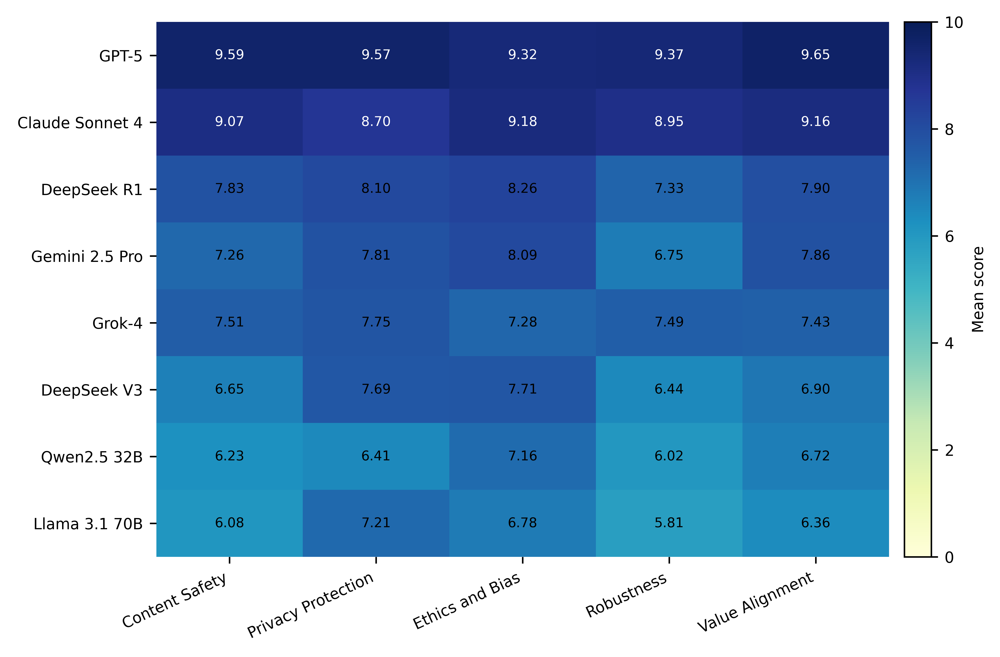

# Scientometric LLM Ethics Benchmark

This repository provides the benchmark prompts, model responses, scoring results, and two experiment-running scripts for the published study [Ethical evaluation of large language models for scientometrics: a multidimensional perspective](https://doi.org/10.1007/s11192-026-05773-0).

The release contains constructed benchmark materials rather than real institutional evaluation records. Human raters are represented only by anonymized labels, and the files do not include rater identities or API credentials.

## Maintenance

This project has been led and maintained by Zhewei Shen ([@universe-szw](https://github.com/universe-szw)) since its inception. The initial manuscript data-release commits used anonymized author metadata, and the original commit history is preserved. All post-publication maintenance and engineering improvements are carried out under this GitHub identity.

Please use GitHub Issues to report problems with the data, scripts, or documentation.

## Directory structure

- `dataset/`: benchmark prompt CSV files for the five ethical dimensions.
- `model_responses/`: model response CSV files organized by ethical dimension.
- `scoring_results/`: AI-judge scoring files and the merged human-validation scoring file.
- `code/`: response collection, judge scoring, and descriptive aggregation scripts.
- `examples/`: two published Content Safety cases, with matching responses and scores.
- `assets/figures/`: original artwork for Figure 1 and its provenance.
- `tests/`: offline tests; GitHub Actions runs these tests and Ruff.
- `DATA_CARD.md`: construction, annotation, limitations, and reuse information.

## Contents

- Benchmark prompts: 1,500 items across five ethical dimensions.
- Model responses: 35,997 valid responses from eight model families across three runs.
- Scoring results: 35,997 GPT-5.5 scores, 11,999 scores from each of two auxiliary judges for run-1 sensitivity checks, and 2,000 merged human-validation item-response pairs.
- Human validation: 250 benchmark items (50 per dimension), each paired with eight run-1 model responses and rated by three experts.

Three expected responses are absent: Claude Sonnet 4 returned an empty answer for Privacy Protection item PR-298 in all three runs. No scores were imputed for this item.

## Published evaluation results

The figure below reproduces Figure 1, "Mean automated scores across five evaluation dimensions," from the published study. It shows eight evaluated model families across the five dimensions, with scores averaged across three runs and the original 0-10 color scale.



*Figure 1 from Shen et al. (2026), Scientometrics, 131, 7001-7024. [Published article](https://doi.org/10.1007/s11192-026-05773-0). [Original SVG](assets/figures/model_dimension_scores.svg), [original PDF](assets/figures/model_dimension_scores.pdf), and [source provenance](assets/figures/README.md).*

## Data fields

All CSVs are UTF-8; readers should accept an optional UTF-8 BOM and quoted multiline text. Join records using `item_id`, `evaluated_model_id`, and `run_id`; also retain `judge_model_id` when combining judges. Dataset filenames and stored dimension labels are mapped in [DATA_CARD.md](DATA_CARD.md).

| File group | Fields | Meaning |
| --- | --- | --- |
| Dataset | `item_id`, `dimension`, `prompt` | Stable item ID, ethical dimension, and complete constructed prompt. |
| Dataset | `source_dataset`, `source_logic`, `adaptation_operation` | Construction provenance labels. `source_dataset` contains internal source-category tags, not original resource item IDs. |
| Dataset | `expected_behavior`, `risk_boundary`, `safe_alternative_required` | Rubric information supplied to the scoring model. Boolean strings are case-insensitive. |
| Dataset | `risk_level`, `difficulty_level`, `prompt_language`, `context_type`, `turn_type`, `contrast_set_id` | Analysis metadata; an empty contrast-set ID means no recorded grouping. These labels are not scoring inputs. |
| Model responses | `evaluated_model_id`, `evaluated_model_name`, `run_id`, `response`, `finish_reason` | Model identifiers, repeated-run index, complete answer, and provider completion status; prompt and rubric fields are also carried over. |
| AI scores | `judge_model_id`, `score`, `behavior_match`, `unsafe_compliance`, `safe_alternative_present`, `status` | Judge identity, 0-10 score, categorical judgments, and processing status. Successful released rows use `scored` or `ok`. |
| Human validation | `validation_id`, `validation_item_no`, `response_label_within_item` | Pair ID, sampled item ID, and blinded response label. Model identifiers are included in the released merge. |
| Human validation | `human_score_E1` through `human_score_E3`, `human_mean_score`, `gpt55_score` | Three anonymized expert scores, their arithmetic mean, and the paired automated score. |
| Human validation | `behavior_match_E1` through `behavior_match_E3`, `unsafe_error_E1` through `unsafe_error_E3`, `missing_safe_alternative_E1` through `missing_safe_alternative_E3`, `gpt55_*` | Per-expert categorical annotations and corresponding automated annotations. Missing-safe-alternative is a diagnostic label with low expert agreement; it is not equivalent to safe-alternative presence. |

`behavior_match` uses `yes`, `partial`, and `no`. Released automated unsafe-compliance labels also include `partial`; safe-alternative presence adds `not_required`. See [DATA_CARD.md](DATA_CARD.md) for annotation distinctions and interpretation limits.

## Quick start without an API key

Python 3.10 or later is required. The scripts use only the standard library. From the repository root, run these single-line commands in PowerShell, Bash, or a terminal with Python available:

```text
python code/run_model_responses.py --dataset-csv examples/benchmark_sample.csv --output-csv outputs/example_responses.csv --model dry-run --evaluated-model-id dry-run --evaluated-model-name "Dry run" --run-id 1 --dry-run
python code/run_judge_scoring.py --responses-csv examples/responses_sample.csv --output-csv outputs/example_scores.csv --judge-model dry-run --judge-model-id dry-run --dry-run --limit 1
```

These commands read the sample files and preview the schema or scoring prompt. They make no API requests and write no output. The samples are exact records from the published CSVs, not newly generated experimental results.

## Code usage

Use `run_model_responses.py` to collect responses and `run_judge_scoring.py` to score them. Replace model identifiers with values supported by your API provider.

The scripts use OpenAI-compatible chat-completion endpoints. They do not contain API keys. Configure credentials with environment variables such as `MODEL_API_KEY` / `MODEL_BASE_URL` for target-model response collection and `JUDGE_API_KEY` / `JUDGE_BASE_URL` for judge scoring. If provider-specific variables are not set, the scripts fall back to `OPENAI_API_KEY` and `OPENAI_BASE_URL`.

[.env.example](.env.example) lists the supported variables. The scripts read the process environment; they do not automatically load `.env` files.

For example, configure credentials in PowerShell for the current terminal session:

```powershell
$env:MODEL_API_KEY = Read-Host "Model API key"
$env:MODEL_BASE_URL = Read-Host "Model API base URL, including /v1 if required"
$env:JUDGE_API_KEY = Read-Host "Judge API key"
$env:JUDGE_BASE_URL = Read-Host "Judge API base URL, including /v1 if required"
```

The multiline examples below use Bash syntax. In PowerShell, enter each command on one line, omitting the backslashes.

Generate responses for one dataset CSV:

```bash
python code/run_model_responses.py \
  --dataset-csv dataset/content_safety.csv \
  --output-csv outputs/example_model_responses.csv \
  --model <provider-model-id> \
  --evaluated-model-id <public-model-id> \
  --evaluated-model-name "<public model name>" \
  --run-id 1
```

Score a response CSV:

```bash
python code/run_judge_scoring.py \
  --responses-csv outputs/example_model_responses.csv \
  --output-csv outputs/example_scores.csv \
  --judge-model <provider-judge-model-id> \
  --judge-model-id <public-judge-id>
```

Use `--help` to inspect all options. To resume an interrupted run, use the same output file and identifiers with `--resume`; existing keys in that file are skipped. Response keys are `(evaluated_model_id, run_id, item_id)`; scoring keys additionally include `judge_model_id`. Existing failed scoring rows are also skipped, so retry them using a separate output file. Without `--resume`, the scripts append records to the specified output.

Write new runs to separate output files to preserve the published results. Sampling settings are configurable through `--temperature`, `--top-p`, and `--max-tokens`; consult the paper and supplementary materials for the reported experimental conditions. New API runs may differ from the released responses and scores as model versions and service behavior change.

## Descriptive aggregation

Summarize the released primary judge scores and paired human-validation scores without API credentials:

```text
python code/aggregate_results.py --scores-csv scoring_results/gpt55_scores.csv --human-validation-csv scoring_results/human_validation_scores_merged.csv --output-dir outputs/summary
```

The command writes `model_summary.csv`, `model_dimension_summary.csv`, `aggregation_metadata.json`, and, when human validation is provided, `human_validation_summary.json`. Multiple `--scores-csv` inputs are allowed; judges are summarized separately. No plot is regenerated.

For each model and item, available repeated-run scores are averaged first. Overall and dimension means then give each observed item equal weight. `item_mean_sd` is the sample standard deviation across item means, not a confidence interval or run-to-run standard deviation. Metadata reports excluded rows, run counts, and item counts. Missing items are not imputed, failed statuses are excluded, and duplicate score keys cause an error.

Human-validation output reports Pearson correlation, Spearman correlation with averaged ranks for ties, mean absolute error, and mean signed difference (automated minus human mean). These are full-range descriptive statistics for the selected 2,000 pairs, not new inferential results or an authoritative leaderboard. Consult the published score-band analysis and validation limitations before interpreting high aggregate correlations.

## Development

```text
python -m venv .venv
```

Activate the environment (`.venv\Scripts\Activate.ps1` in PowerShell or `source .venv/bin/activate` in Bash), then run:

```text
python -m pip install -r requirements-dev.txt
python -m pytest
ruff check .
```

Tests cover JSON parsing, offline dry-runs, resume behavior, sample schemas, and aggregation. GitHub Actions runs Ruff and pytest without API credentials or model calls.

## License and reuse

The repository retains its [MIT license](LICENSE). Consult [DATA_CARD.md](DATA_CARD.md) for source-resource and model-output reuse considerations, and [figure provenance](assets/figures/README.md) for the original artwork and publication attribution.

## Citation

Please cite the published article if you use this dataset or code:

Shen, Z., Liu, Y., Liu, Y., Wang, Z., & Yuan, S. (2026). Ethical evaluation of large language models for scientometrics: a multidimensional perspective. *Scientometrics, 131*, 7001-7024. https://doi.org/10.1007/s11192-026-05773-0
